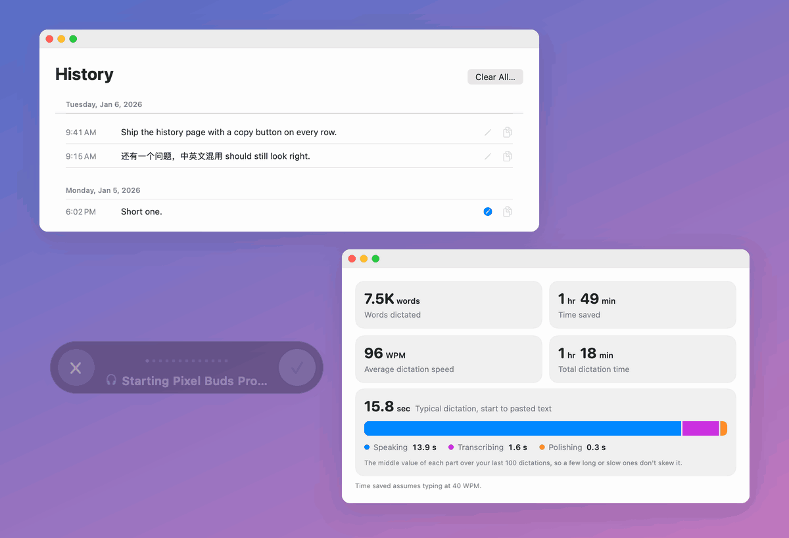

# DictationApp

**Hold a key, speak, let go: your words are typed into any app on your Mac.**

A small macOS menu-bar app for fast, private dictation. It runs on your Mac by default, and
cloud models can handle **English mixed into Chinese**, which the built-in macOS dictation can't.



## Features

- **Works everywhere.** Hold **Fn** (or Right ⌘ / ⌥ / ⌃ / ⇧, or a mouse button), speak, and let go.
  The text is pasted at your cursor in whatever app you're in.
- **Live recording bar.** A small bar at the bottom of the screen shows a waveform and which mic
  is recording. Click ✓ to paste, or ✕ / **Esc** to cancel. Bluetooth headsets take about a second
  to start their mic: the bar shows the wait, then flashes green when you can talk. It glows red if
  no audio is coming in.
- **Intelligent mic selection.** Picked the wrong mic? While you dictate, your wired and built-in
  mics listen too. If one hears you clearly better, the dictation switches to it with nothing lost
  (the bar flashes yellow), and it becomes your mic from then on. On by default; Settings → Audio.
- **On-device or cloud.** *On-device* uses Apple Speech, and no audio leaves your Mac.
  *Cloud Flash* returns text about 0.5 s after you stop, and *Cloud Big* in about 2 s. Both handle
  English mixed into Chinese.
- **Optional AI polish.** Removes filler words and fixes self-corrections ("Tuesday, no,
  Wednesday") without changing your meaning. On-device setups polish with Apple Intelligence,
  cloud setups with DeepSeek. It's off by default; turn it on from the menu bar. Polish never
  holds you up: if it fails or takes longer than 6 s, you get your unpolished text.
- **Type as you speak.** Optionally types each phrase as soon as you pause, instead of pasting
  everything at the end.
- **History and corrections.** Past dictations, grouped by day and searchable, kept only on your
  Mac. When a dictation comes out wrong, click the pencil and type what you meant. Corrections
  become a test set for comparing models and prompts.
- **Learn from your corrections.** With ten corrections, one click tunes the cloud setups' polish
  prompt from them: a strong model rewrites the prompt three ways, your own polish model runs each,
  and the best becomes the next prompt version. The score you see is cross-validated (no
  correction scores a prompt written from it), and a general test set guards against a prompt that
  only learned your corrections. Each version is kept, with its scores, under Settings → Model.
- **Insights.** Words dictated, time saved compared with typing, your speaking speed, and where a
  typical dictation's time goes (speaking, transcribing, polishing).
- **Your clipboard is kept.** It's saved before each paste and restored about a second later.
- **Lots of options.** Hold to talk or tap to toggle, a mouse button that presses Return, apps
  where the hotkey is paused (e.g. games), mute audio while dictating, launch at login, and
  [your own model setups](docs/custom-setups.md).

## Requirements

- macOS 26 or later
- Swift 6 toolchain (Xcode 26 or its Command Line Tools)
- For the cloud setups: an [OpenRouter](https://openrouter.ai) API key
- For on-device AI polish: Apple Intelligence turned on

## Install

There's no prebuilt download yet. Build from source:

```sh
git clone https://github.com/cyc115/dictation-app.git
cd dictation-app
./build.sh        # builds, installs to /Applications, and launches
```

`build.sh` signs the app with a self-signed certificate that it creates once and reuses, so macOS
keeps the app's permissions when you rebuild. Then grant three permissions:

1. **Microphone**: prompted at first launch.
2. **Speech Recognition**: prompted at first launch.
3. **Accessibility**: System Settings → Privacy & Security → Accessibility → turn on DictationApp.
   This lets the app see the hotkey and paste text. Relaunch the app afterwards.

## Usage

| Action | How |
|---|---|
| Dictate | Hold **Fn**, speak, release |
| Paste now / cancel | Click ✓ / click ✕ or press **Esc** |
| Toggle AI polish | Menu bar 🎙 → **AI polish** |
| Insights | Menu bar 🎙 → **Insights…** |
| History | Menu bar 🎙 → **History…** (⌘Y) |
| Settings | Menu bar 🎙 → **Settings…** (⌘,) |

In **Settings → Model**, pick a setup:

| Setup | Speech | Polish | Notes |
|---|---|---|---|
| **On-device** | Apple Speech | Apple Intelligence | Nothing leaves your Mac. English *or* Chinese, one at a time. |
| **Cloud Flash** | Qwen3-ASR 1.7B | DeepSeek V4.1 Flash | Text in about 0.5 s. Handles mixed English/Chinese. |
| **Cloud Big** | Meta Muse Voice | DeepSeek V4.1 Flash | Text in about 2 s. Handles mixed English/Chinese. |

Cloud setups send audio to OpenRouter when you stop recording. Your API key is stored in
`~/Library/Application Support/DictationApp/secrets.json`, readable only by your user account.
If the cloud model hasn't answered after a couple of seconds, a smaller, faster backup model is
asked too and the first answer is used (Settings → *Backup model when slow*).

## Privacy

- The mic is on **only** while you're dictating, never in the background.
- With the On-device setup, audio and text never leave your Mac.
- Audio is thrown away once it's transcribed, unless you turn on *Keep recordings*. Those, and
  your history, stay in `~/Library/Application Support/DictationApp/`.
- History is kept for as long as you choose (Settings → *Keep history*), and **Clear All…**
  deletes it.
- Learning a prompt sends your corrections (the transcript, what the app wrote, what you wanted)
  to the cloud models, like any cloud dictation. Learned prompts stay in
  `~/Library/Application Support/DictationApp/learned-prompts.json`.

## Troubleshooting

- **Nothing happens when I press the hotkey.** Accessibility isn't on yet. Turn it on, then
  relaunch the app.
- **Fn also opens the emoji picker or Apple Dictation.** System Settings → Keyboard → "Press 🌐
  key to" → Do Nothing, or pick a different hotkey.
- **"On-device recognition unavailable".** System Settings → Keyboard → Dictation: make sure
  your language is turned on, so its on-device model is downloaded.
- **AI polish does nothing.** On-device polish needs Apple Intelligence. Cloud polish needs a
  valid API key. If polish fails, the unpolished text is pasted.
- **Text lands in the wrong app.** Click the text field you want first, then hold the hotkey.

## Development

```sh
./test.sh                    # unit, UI, snapshot and performance-budget tests
./test.sh --live             # + the real cloud API, both cloud models (needs $OPENROUTER_API_KEY)
./test.sh --perf             # + launch time, idle CPU and memory of the installed app
./build.sh --keep-running    # install without interrupting a dictation; relaunches when idle
bench/suite.py latency run   # time from stop to text, per speech/polish model
bench/suite.py polish run    # polish quality on tricky dictations
```

- `Sources/DictationKit`: all app code. `Sources/DictationApp`: the entry point.
  `Tests/DictationKitTests`: the tests.
- **UI tests** host the real SwiftUI views in an offscreen window and click through them using
  their accessibility identifiers.
- **Snapshot tests** compare rendered views with `Tests/DictationKitTests/__Snapshots__/`. After
  a deliberate UI change, run `RECORD_SNAPSHOTS=1 ./test.sh --filter SnapshotTests`, then
  `scripts/readme-screenshot.py` to rebuild the screenshot above.
- **Performance tests** fail when hot paths (audio processing, the recording bar, saving and
  loading history) go over their time budgets.
- **Benchmarks** in [`bench/`](bench/README.md) compare speech models, polish models and prompts
  on generated speech, your own recordings or your corrections.

Contributor and agent conventions are in [`AGENTS.md`](AGENTS.md).

## Uninstall

Delete `/Applications/DictationApp.app`, remove it from System Settings → Privacy & Security →
Accessibility, Microphone and Speech Recognition, and optionally delete
`~/Library/Application Support/DictationApp/`.
