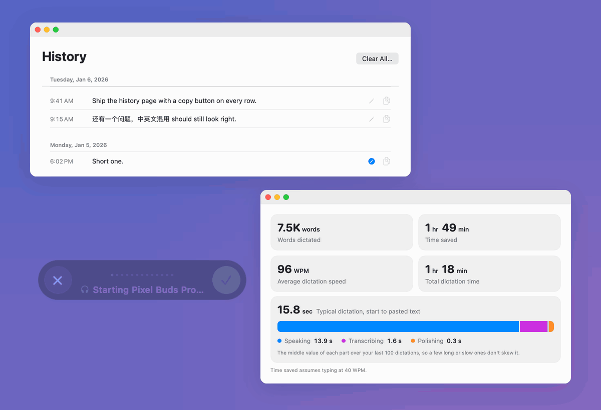
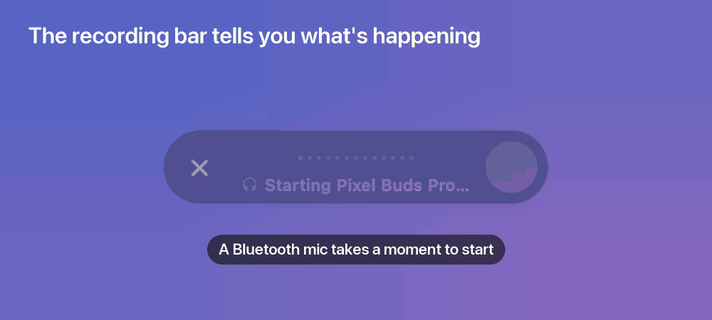
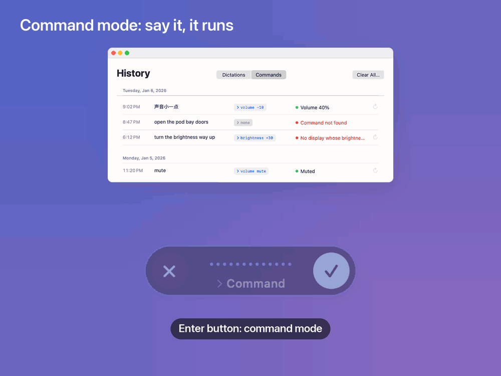
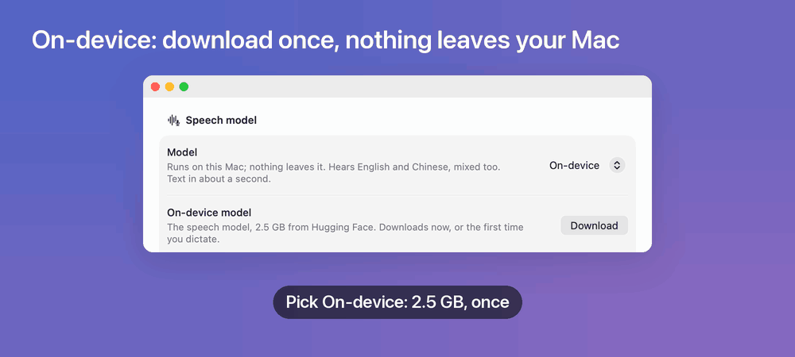
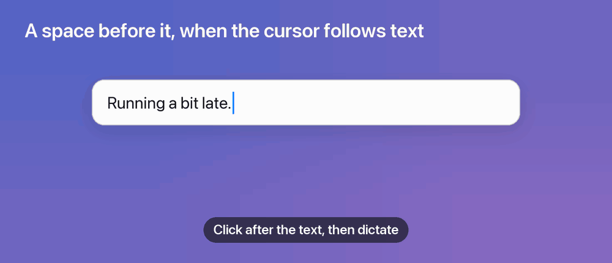
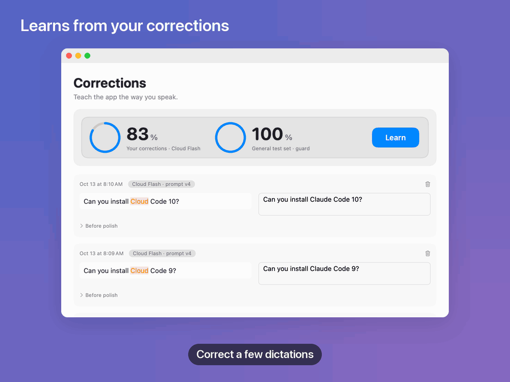
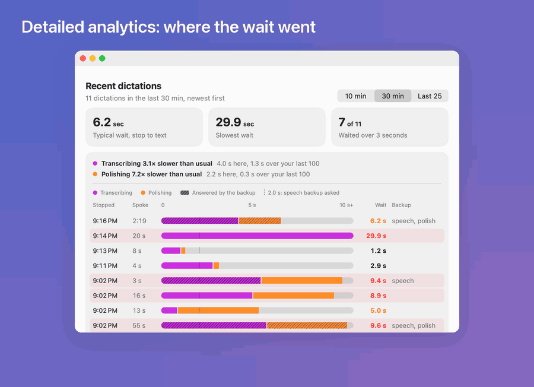

# DictationApp

**Hold a key, speak, let go: your words are typed into any app on your Mac.**

A small macOS menu-bar app for fast, private dictation. It runs on your Mac by default, and
cloud models can handle **English mixed into Chinese**, which the built-in macOS dictation can't.



## What it does

### The recording bar tells you what's happening

A small bar at the bottom of the screen shows a waveform and which mic is recording. Bluetooth
headsets take about a second to start: the bar shows the wait, then flashes **green** when you can
talk. **Yellow**: it moved to a mic that hears you better (your wired and built-in mics listen too),
with nothing lost. **Red**: no sound is coming in. Click ✓ to paste, ✕ or **Esc** to cancel.



### Command mode: say it, it runs

Press the Enter mouse button when you're not dictating, say what you want ("make the screen a bit
brighter", "声音小一点", "mute"), and press it again. A decision model picks one of your commands in
about 0.3 s and it runs; if nothing fits, nothing runs. "打开 Safari" opens an app you installed.
Commands are small Python scripts in a folder you can edit ([how](#commands)), or say "create
command" and what it should do, and one is written for you (about a second). History keeps a
Commands list with ↻ to run one again. Command mode is online: it needs your API key, whatever the
speech setup.



### On-device: nothing leaves your Mac

The *On-device* setup runs Qwen3-ASR on your Mac's GPU: text about a second after you stop, no
network stalls, English, Chinese and both mixed. The model (2.5 GB) downloads once from Hugging
Face, with progress in Settings. Prefer the cloud? *Cloud Flash* is about 0.5 s and *Cloud Big*
about 2 s ([setups](#usage)).



### A space where it belongs

The text is pasted at your cursor in any app. When the cursor follows other text, a space goes in
first, but not after a space or line break, not before punctuation, and not between two Chinese
characters. Your clipboard is put back about a second later.



### Learns from your corrections

When a dictation comes out wrong, click the pencil in History and type what you meant. With ten
corrections, one click tunes the cloud setups' polish prompt from them: a strong model rewrites it
three ways, your own polish model runs each, and the best becomes the next version. You see its
score on your corrections (cross-validated) and on a general test set before you keep it.



### Detailed analytics: where the wait went

Home shows words dictated, time saved and where a typical dictation's time goes. Settings → *Show
detailed analytics* adds your recent dictations one by one: transcribing and polishing time,
which model answered (main or backup), and how often the backup was needed.



### And also

- **Works everywhere.** Hold **Fn** (or Right ⌘ / ⌥ / ⌃ / ⇧, or a mouse button), speak, let go.
- **Optional AI polish.** Removes filler words and fixes self-corrections ("Tuesday, no,
  Wednesday") without changing your meaning: Apple Intelligence on-device, DeepSeek in the cloud.
  Off by default (menu bar → AI polish). If it fails or takes over 6 s, you get your unpolished text.
- **Dictate and send.** The Enter mouse button, while dictating, stops, pastes and presses Return.
- **History**, grouped by day and searchable, kept only on your Mac for as long as you choose.
- **Lots of options.** Hold to talk or tap to toggle, apps where the hotkey is paused (e.g. games),
  mute audio while dictating, launch at login, and [your own model setups](docs/custom-setups.md).

## Requirements

- macOS 26 or later on Apple silicon
- To build: Xcode 26 or later with its Metal Toolchain (`xcodebuild -downloadComponent MetalToolchain`)
- For the cloud setups: an [OpenRouter](https://openrouter.ai) API key
- For on-device AI polish: Apple Intelligence turned on

## Install

**Download:** get the latest `DictationApp-*.zip` from
[Releases](https://github.com/cyc115/dictation-app/releases), unzip it and move
`DictationApp.app` to `/Applications`. It's signed with a self-signed certificate, not an Apple
Developer ID, so macOS blocks it the first time: run
`xattr -dr com.apple.quarantine /Applications/DictationApp.app`, or open it once and then click
System Settings → Privacy & Security → **Open Anyway**. Releases are built for Apple silicon.

**Or build from source:**

```sh
git clone https://github.com/cyc115/dictation-app.git
cd dictation-app
./build.sh        # builds, installs to /Applications, and launches
```

`build.sh` signs the app with a self-signed certificate that it creates once and reuses, so macOS
keeps the app's permissions when you rebuild. Then grant three permissions:

1. **Microphone**: prompted at first launch.
2. **Speech Recognition**: prompted at first launch.
3. **Accessibility**: System Settings → Privacy & Security → Accessibility → turn on DictationApp.
   This lets the app see the hotkey and paste text. Relaunch the app afterwards.

## Usage

| Action | How |
|---|---|
| Dictate | Hold **Fn**, speak, release |
| Paste now / cancel | Click ✓ / click ✕ or press **Esc** |
| Dictate and send | Enter mouse button while dictating: stops, pastes, presses Return |
| Run a command | Enter mouse button when not dictating, speak, press it again |
| Toggle AI polish | Menu bar 🎙 → **AI polish** |
| Insights | Menu bar 🎙 → **Insights…** |
| History | Menu bar 🎙 → **History…** (⌘Y) |
| Settings | Menu bar 🎙 → **Settings…** (⌘,) |

In **Settings → Model**, pick a setup:

| Setup | Speech | Polish | Notes |
|---|---|---|---|
| **On-device** | Qwen3-ASR 1.7B, on your Mac | Apple Intelligence | Nothing leaves your Mac. Text in about 1 s. Handles mixed English/Chinese. |
| **Cloud Flash** | Qwen3-ASR 1.7B | DeepSeek V4.1 Flash | Text in about 0.5 s. Handles mixed English/Chinese. |
| **Cloud Big** | Meta Muse Voice | DeepSeek V4.1 Flash | Text in about 2 s. Handles mixed English/Chinese. |

Cloud setups send audio to OpenRouter when you stop recording. Your API key is stored in
`~/Library/Application Support/DictationApp/secrets.json`, readable only by your user account.
If the cloud model hasn't answered after a couple of seconds, a smaller, faster backup model is
asked too and the first answer is used (Settings → *Backup model when slow*).

## Commands

Command mode runs the scripts in `~/Library/Application Support/DictationApp/Commands/`
(Settings → Commands → **Show in Finder**). The app starts you with `brightness` (built-in
display) and `volume`, plus four built-in commands: `return` ("send it"), `repeat` (the last
command again), `open` (an app in `/Applications` or `~/Applications`, not the ones macOS comes
with) and `create`. The folder is read afresh for every command, so a new script works right away.

`create` ("create command, tile the window to the left half", "新建命令 现在几点") has DeepSeek V4.1
Flash write the script into the folder, ready next time; if one of your commands already does it,
it says which instead. The script isn't run when it's written. A script that fails (exits non-zero
or takes over 10 s) is turned off: it moves to `Commands/Disabled/`, and Settings → Commands has a
switch beside each script to turn it back on (or off).

A command is one Python file, run with `uv run --script <file> <choice>`. Its docstring's first
line says what it does, and the lines under `Choices:` list what it can be told:

```python
"""Set the sound volume, or mute it.

Choices:
    +10: a bit louder
    -10: a bit quieter
    50: half
    mute: mute
"""
```

What it prints first is shown in the pill (“Volume 40%”); exiting with an error shows the last
line it wrote to stderr. The decision model, TypeSafe's Jev through OpenRouter's decisions API,
answers multiple-choice questions, so a command takes one of its listed choices rather than free
text. It sees what you said and each command's description and choices, never the scripts.

## Privacy

- The mic is on **only** while you're dictating, never in the background.
- With the On-device setup, audio and text never leave your Mac.
- Audio is thrown away once it's transcribed, unless you turn on *Keep recordings*. Those, and
  your history, stay in `~/Library/Application Support/DictationApp/`.
- History is kept for as long as you choose (Settings → *Keep history*), and **Clear All…**
  deletes it.
- Command mode sends what you said, and your commands' names, descriptions and choices (with your
  installed apps' names, for `open`), to OpenRouter to pick one; `create` also sends it to
  DeepSeek to write the script. Commands are saved beside your history, in `history-commands.json`.
- Learning a prompt sends your corrections (the transcript, what the app wrote, what you wanted)
  to the cloud models, like any cloud dictation. Learned prompts stay in
  `~/Library/Application Support/DictationApp/learned-prompts.json`.

## Troubleshooting

- **Nothing happens when I press the hotkey.** Accessibility isn't on yet. Turn it on, then
  relaunch the app.
- **Fn also opens the emoji picker or Apple Dictation.** System Settings → Keyboard → "Press 🌐
  key to" → Do Nothing, or pick a different hotkey.
- **"The on-device model is still downloading".** It downloads once (2.5 GB), when you first pick
  On-device or dictate with it; Settings → Model shows the progress. On power it then stays in
  memory (2.6 GB); on battery it's let go 30 minutes after your last dictation and reloads (about a
  second) while you speak the next one.
- **AI polish does nothing.** On-device polish needs Apple Intelligence. Cloud polish needs a
  valid API key. If polish fails, the unpolished text is pasted.
- **Text lands in the wrong app.** Click the text field you want first, then hold the hotkey.

## Development

```sh
./test.sh                    # unit, UI, snapshot and performance-budget tests
./test.sh --live             # + the real cloud API, both cloud models (needs $OPENROUTER_API_KEY)
./test.sh --perf             # + launch time, idle CPU and memory of the installed app
./build.sh --keep-running    # install without interrupting a dictation; relaunches when idle
scripts/release.sh           # test, build and publish a GitHub release (--draft, --dry-run)
bench/suite.py latency run   # time from stop to text, per speech/polish model
bench/suite.py polish run    # polish quality on tricky dictations
```

- `Sources/DictationKit`: all app code, one folder per feature (`Dictation`, `Speech`, `Polish`, `Pill`,
  `History`, `Commands`, …). `Sources/DictationApp`: the entry point.
  `Tests/DictationKitTests`: the tests.
- **UI tests** host the real SwiftUI views in an offscreen window and click through them using
  their accessibility identifiers.
- **Snapshot tests** compare rendered views with `Tests/DictationKitTests/__Snapshots__/`. After
  a deliberate UI change, run `RECORD_SNAPSHOTS=1 ./test.sh --filter SnapshotTests`, then
  `scripts/readme-gifs.py render` to rebuild the animations above (from the real pill and views,
  with fixture data; `list` shows the scenes).
- **Performance tests** fail when hot paths (audio processing, the recording bar, saving and
  loading history) go over their time budgets.
- **Benchmarks** in [`bench/`](bench/README.md) compare speech models, polish models and prompts
  on generated speech, your own recordings or your corrections.

Contributor and agent conventions are in [`AGENTS.md`](AGENTS.md).

## Uninstall

Delete `/Applications/DictationApp.app`, remove it from System Settings → Privacy & Security →
Accessibility, Microphone and Speech Recognition, and optionally delete
`~/Library/Application Support/DictationApp/`.
